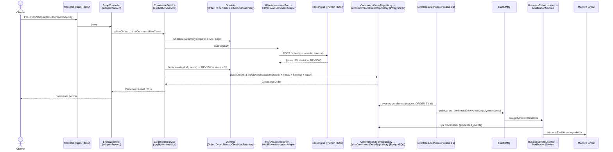
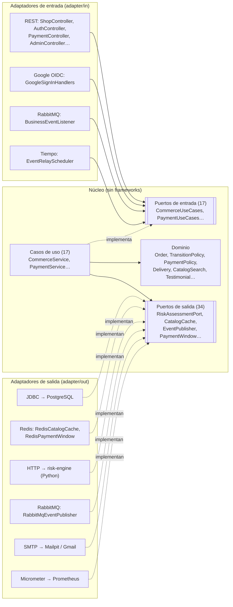
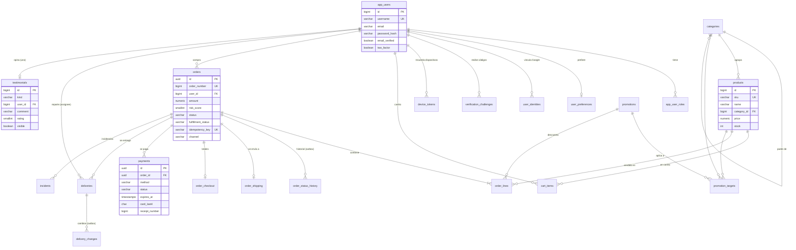
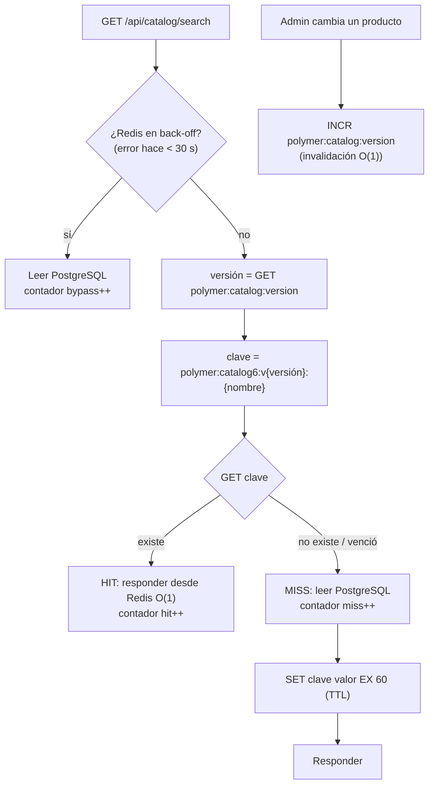
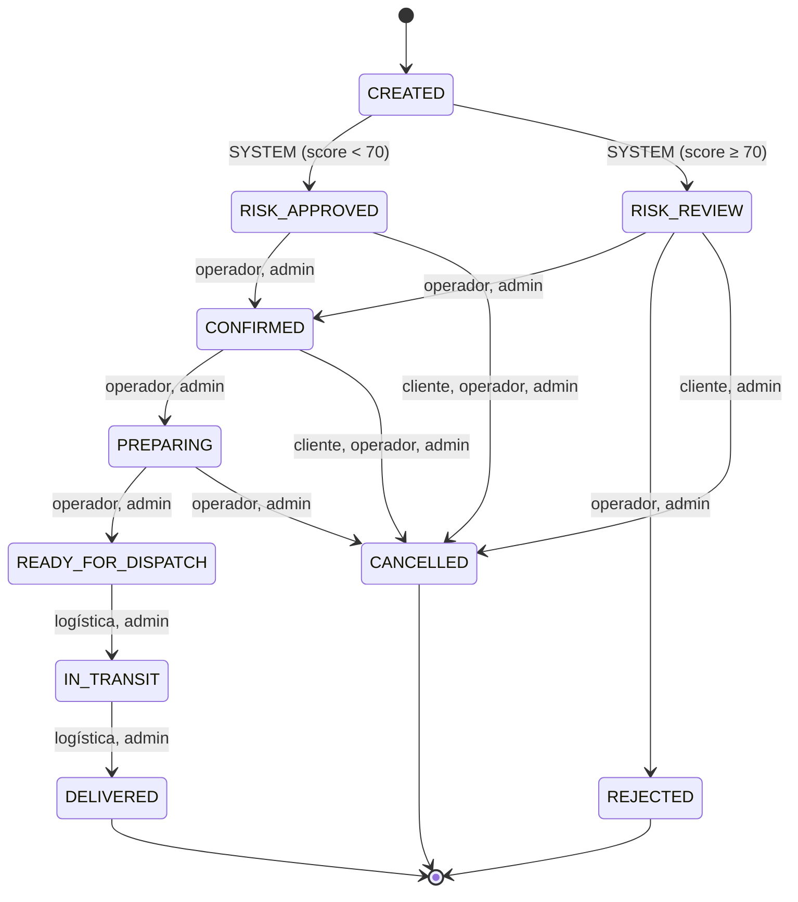

# Defensa de POLYMER: arquitectura hexagonal explicada de principio a fin

Guía para **explicar y demostrar** POLYMER ante el profesor del curso de **Algoritmos y Estructuras de Datos (AED II)**.
Todo lo que se afirma aquí apunta a un archivo real del repositorio (ruta y, cuando ayuda, línea) para abrirlo en
**VS Code** mientras se explica. Las rutas Java son relativas a
`services/order-api/src/main/java/com/polymer/` salvo que se indique otra cosa.

> Documentos de apoyo que esta guía resume: `ARQUITECTURA_HEXAGONAL.md` (recorrido de un pedido línea por línea),
> `MAPA_SLICES_FUNCIONALES.md` (endpoints de cada slice), `DEMOSTRACION_*.md` (una por tecnología),
> `GUIA_EXPOSICION_PROFESOR.md` (escenarios automatizados), `diagramas/` (draw.io).

---

## Índice

**Parte I · Fundamentos**
1. [Qué es la arquitectura hexagonal, quién la propuso y por qué](#1-qué-es-la-arquitectura-hexagonal)
2. [Ventajas y desventajas (con evidencia en POLYMER)](#2-ventajas-y-desventajas)
3. [El enfoque de Algoritmos y Estructuras de Datos](#3-el-enfoque-de-algoritmos-y-estructuras-de-datos)

**Parte II · POLYMER por dentro**
4. [Mapa del código en VS Code y la regla de dependencias](#4-mapa-del-código-en-vs-code)
5. [Qué hace cada capa: domain, application, infrastructure](#5-qué-hace-cada-capa)
6. [Los slices, uno por uno, por capa](#6-los-slices-uno-por-uno)
7. [Recorrido completo de una compra (secuencia)](#7-recorrido-completo-de-una-compra)
8. [Microservicios: qué hay realmente](#8-microservicios-qué-hay-realmente)

**Parte III · Infraestructura**
9. [Los 13 contenedores: qué hace cada uno, dónde está y qué pasa si se cae](#9-los-13-contenedores)
10. [De dónde salen los datos de Grafana](#10-de-dónde-salen-los-datos-de-grafana)
11. [Colas de mensajería y circuit breaker](#11-colas-de-mensajería-y-circuit-breaker)

**Parte IV · TTL**
12. [Qué es el TTL y los cuatro TTL de POLYMER](#12-qué-es-el-ttl)

**Parte V · Demostraciones**
13. [Demostraciones con cambios de código (paso a paso)](#13-demostraciones-con-cambios-de-código)
14. [«¿Qué pasaría si…?»](#14-qué-pasaría-si)

**Parte VI · Diagramas y preguntas**
15. [Diagramas: arquitectura, base de datos (E-R) y flujos](#15-diagramas)
16. [Preguntas probables del profesor (con la respuesta y el archivo)](#16-preguntas-probables)

---

# Parte I · Fundamentos

## 1. Qué es la arquitectura hexagonal

### 1.1 Origen

- La propuso **Alistair Cockburn** (uno de los autores del *Manifiesto Ágil*). Publicó el artículo
  *«Hexagonal Architecture»* en **2005**; su nombre formal es **Ports and Adapters** (*puertos y adaptadores*).
- Problema que quería resolver: en muchas aplicaciones la **lógica de negocio queda mezclada** con la interfaz de
  usuario y con la base de datos. Eso impide probarla sin levantar todo el sistema y obliga a reescribirla cuando
  cambia la tecnología.
- Ideas de la misma familia que vinieron después: **Onion Architecture** (Jeffrey Palermo, 2008) y
  **Clean Architecture** (Robert C. Martin, 2012). Las tres comparten la idea central: **el negocio en el centro y
  las dependencias del código apuntando hacia dentro**.
- ¿Por qué un **hexágono**? No porque haya seis piezas: Cockburn lo dibujó así para dejar espacio a **varios lados**
  (varias formas de entrar y de salir) y romper con el dibujo clásico de «capas apiladas» (arriba UI, abajo base de datos).

### 1.2 Las piezas

| Pieza | Qué es | En POLYMER |
| --- | --- | --- |
| **Núcleo (dominio)** | Las reglas del negocio, en código puro (sin frameworks) | `domain/` (Java) y `risk_engine/domain/` (Python) |
| **Casos de uso** | Orquestan el dominio para cumplir una intención del usuario | `application/service/` (17 servicios) |
| **Puerto de entrada** (*driving port*) | Interfaz con lo que el sistema **ofrece** | `application/port/in/` (17 interfaces, p. ej. `CommerceUseCases`) |
| **Puerto de salida** (*driven port*) | Interfaz con lo que el núcleo **necesita** del exterior | `application/port/out/` (34 interfaces, p. ej. `RiskAssessmentPort`, `CatalogCache`) |
| **Adaptador de entrada** (primario) | Traduce el mundo exterior → puerto de entrada | `adapter/in/`: controladores REST, oyente de RabbitMQ, planificador |
| **Adaptador de salida** (secundario) | Implementa un puerto de salida con una tecnología concreta | `adapter/out/`: JDBC (PostgreSQL), Redis, RabbitMQ, SMTP, HTTP, Micrometer |
| **Raíz de composición** | El único lugar que conoce ambos lados y los conecta | `config/` (clases `@Configuration`) y `risk_engine/bootstrap.py` |

### 1.3 La regla que lo define todo: **inversión de dependencias**

El caso de uso **no conoce** PostgreSQL, ni Redis, ni Python, ni HTTP. Conoce **interfaces** (puertos). Ejemplo real:

```java
// application/port/out/RiskAssessmentPort.java  →  lo que el núcleo NECESITA (contrato)
// adapter/out/http/HttpRiskAssessmentAdapter.java →  una forma de cumplirlo (HTTP al servicio Python)
// adapter/out/fixed/FixedRiskAssessmentAdapter.java → OTRA forma de cumplirlo (puntaje fijo, para demostrar)
// application/service/CommerceService.java         →  usa risk.assess(draft) sin saber cuál de los dos recibió
```

Quien decide cuál se usa es `config/HexagonalConfiguration.java` (la raíz de composición), líneas 58 y 72: con la
propiedad `polymer.risk.adapter` (variable `POLYMER_RISK_ADAPTER`) en `http` (por defecto) o `fixed`. **Cambiar de adaptador no toca ni una línea del caso de uso.**
Eso es la arquitectura hexagonal en una frase.

### 1.4 Cómo se comprueba que se cumple (no basta con decirlo)

`services/order-api/src/test/java/com/polymer/architecture/HexagonalArchitectureTest.java` usa **ArchUnit**: ocho
reglas que **fallan la compilación** (el `mvn verify` del Dockerfile) si alguien rompe la arquitectura:

| Regla (línea) | Qué impide |
| --- | --- |
| `CORE_HAS_NO_FRAMEWORK_OR_INFRASTRUCTURE` (16) | Que `domain` o `application` importen Spring, JDBC, Jackson, HTTP, Redis, RabbitMQ o Micrometer |
| `DOMAIN_IS_INNERMOST` (23) | Que el dominio dependa de la aplicación o de los adaptadores |
| `ADAPTERS_ARE_INDEPENDENT` (27) | Que un adaptador de entrada use uno de salida (deben hablar por puertos) |
| `DRIVING_ADAPTERS_USE_INPUT_PORTS_ONLY` (32) | Que un controlador llame directamente a un servicio en vez de a su puerto |
| `PORTS_ARE_CONTRACTS` (39) | Que un puerto sea otra cosa que una interfaz o un `record` de datos |
| `PORTS_DO_NOT_DEPEND_ON_IMPLEMENTATIONS` (45) | Que un puerto conozca una implementación |
| `OUTPUT_ADAPTERS_IMPLEMENT_OUTPUT_PORTS` (50) | Que un adaptador de salida no implemente un puerto |
| `USE_CASES_IMPLEMENT_INPUT_PORTS` (56) | Que un `*Service` no implemente su puerto de entrada |

En Python, `services/risk-engine/tests/test_architecture.py` hace lo mismo con el microservicio de riesgo.

---

## 2. Ventajas y desventajas

| Ventaja | Evidencia en POLYMER |
| --- | --- |
| **El negocio se prueba sin infraestructura** | 172 pruebas Java: las del dominio y los casos de uso usan *fakes* en memoria (p. ej. `TestimonialServiceTest`, `SignInServiceTest`) y corren en segundos sin PostgreSQL ni Redis |
| **Cambiar una tecnología no toca el negocio** | `CatalogCache` tiene dos implementaciones (`RedisCatalogCache` y `CatalogCache.NONE`); el modo `basic` arranca sin Redis y la tienda funciona igual |
| **Sustituir un adaptador en caliente** | `FixedRiskAssessmentAdapter` reemplaza al servicio Python con una variable de entorno (escenario `adaptador`) |
| **Añadir canales sin reescribir** | Google (OpenID Connect) se añadió como **otro adaptador de entrada** que llama al mismo `SignInUseCases` |
| **Resiliencia más fácil** | Si Redis falla, el puerto `CatalogCache` sigue cumpliéndose leyendo PostgreSQL (`RedisCatalogCache`, back-off de 30 s) |
| **Reglas protegidas automáticamente** | ArchUnit (8 reglas) + pruebas: si se viola la arquitectura o una regla, la imagen Docker **no se construye** |
| **Código ordenado por intención** | Cada slice tiene su puerto, su servicio y sus adaptadores: se encuentra rápido en VS Code |

| Desventaja | Cómo se nota en POLYMER / cómo se mitiga |
| --- | --- |
| **Más archivos e interfaces** (más «ceremonia») | 17 puertos de entrada y 34 de salida. Se mitiga con nombres consistentes (`XxxUseCases` → `XxxService` → `JdbcXxx`) |
| **Curva de aprendizaje** | Hay que entender la inversión de dependencias; se mitiga con esta guía y con ArchUnit, que explica el error |
| **Traducciones entre capas** | Los controladores convierten JSON → `record` del dominio (p. ej. `TestimonialController.View`) |
| **Riesgo de sobre-ingeniería en proyectos pequeños** | Para un CRUD trivial sobra; en POLYMER se justifica porque hay 4 tecnologías externas que pueden fallar o cambiar |
| **No reemplaza al buen diseño del dominio** | Si la regla está mal, la hexagonal no la arregla; por eso las reglas viven en el dominio y tienen pruebas |

**Lectura empresarial:** una tienda real cambia de pasarela de pagos, de proveedor de correo o de base de datos con el
tiempo. Con puertos y adaptadores ese cambio es **un adaptador nuevo**, no reescribir el negocio. POLYMER lo
demuestra con las pasarelas de **prueba** de tarjeta y Yape (`SandboxCardGateway`, `SandboxWalletGateway`): una pasarela
real sería otra clase que implemente `CardGateway` y `WalletGateway`.

---

## 3. El enfoque de Algoritmos y Estructuras de Datos

### 3.1 Situación problema (para empezar la exposición)

> **POLYMER** es una tienda de tecnología que recibe **N pedidos** al día sobre un catálogo de **≈ 556 productos** en
> 20 categorías. Cada pedido debe **evaluarse** (riesgo), **guardarse sin perder datos**, **notificarse** por correo y
> **agendarse** para su entrega sin que dos entregas del mismo repartidor **se crucen**. El catálogo se consulta miles
> de veces y casi nunca cambia, y un pago con Yape **vence en 60 s**.
>
> Preguntas de AED: ¿qué **estructura** permite responder el catálogo en O(1) sin consultar la base cada vez? ¿Cómo
> **ordenar** eventos para notificar en el mismo orden en que ocurrieron? ¿Cómo **detectar** en O(1) que un evento ya se
> procesó? ¿Cómo **modelar** qué estados puede seguir un pedido? ¿Cómo decidir en O(1) si dos franjas horarias se
> solapan? La arquitectura hexagonal **organiza** esas soluciones: cada estructura vive en la capa que le corresponde.

### 3.2 Estructuras de datos y algoritmos usados (con su archivo)

| Estructura / algoritmo | Dónde (archivo · línea) | Para qué | Complejidad |
| --- | --- | --- | --- |
| **Tabla hash con expiración (TTL)** | Redis; `adapter/out/cache/RedisCatalogCache.java` (110: `set(key, json, ttl)`) | Caché del catálogo | Lectura/escritura **O(1)** promedio |
| **Política LRU** (*Least Recently Used*) | `infra/compose.base.yml`, Redis: `--maxmemory 48mb --maxmemory-policy allkeys-lru` | Si se llena la memoria, Redis expulsa las claves menos usadas | O(1) aproximado (muestreo) |
| **Versionado de claves** | `RedisCatalogCache.java` (31: `polymer:catalog:version`, 94: clave `v<versión>`) | Invalidar todo el catálogo con **un solo** `INCR` en vez de borrar N claves | **O(1)** frente a O(N) |
| **Cola FIFO** | RabbitMQ: cola `polymer.notifications` (`adapter/messaging/EventContract.java`) | Notificar en orden, sin bloquear la compra | Encolar/desencolar O(1) |
| **Tabla como cola con marca de agua** (*outbox*) | `adapter/out/persistence/JdbcEventOutbox.java` (35: `ORDER BY h.id LIMIT ?`) | Publicar eventos en el orden en que se guardaron | Recorrido por índice B-tree O(log n + k) |
| **Conjunto para idempotencia** | Tabla `processed_events` (PK `event_id, consumer`); `JdbcProcessedEvents.java` (19: `ON CONFLICT DO NOTHING`) | Detectar duplicados: el mismo evento no envía dos correos | Búsqueda por PK O(log n) (B-tree) |
| **Cola de mensajes muertos** (DLQ) | `config/IntegrationConfiguration.java` (90-98) | Apartar mensajes que no se pueden procesar | — |
| **Grafo dirigido (máquina de estados)** | `domain/fulfillment/TransitionPolicy.java` (26: `EnumMap<estado, EnumMap<estado, Set<Actor>>>`) | Qué transición de estado está permitida y para qué rol | Consulta **O(1)** (lista de adyacencia en mapas) |
| **Conjuntos de enumerados** | `domain/fulfillment/FulfillmentStatus.java` (15-17: `EnumSet` de estados terminales y previos al despacho) | Preguntar «¿es terminal?» | O(1) (vector de bits) |
| **Solapamiento de intervalos** | `domain/logistics/Delivery.java` (36: `start < otroFin && otroInicio < fin`) | Rechazar dos entregas del mismo repartidor que se crucen | **O(1)** por par; O(k) contra sus k entregas |
| **Filtrado, ordenamiento y paginación** | `domain/catalog/CatalogSearch.java` (69-71: `filter(...)`, `sort(comparator)`) | Búsqueda del catálogo con facetas | Filtro O(n) + ordenamiento **O(n log n)** (TimSort) |
| **Conteo con mapas** (facetas) | `CatalogSearch.java` (79-93) | «Marca X (12 productos)» | O(n) |
| **Máximo con comparador** | `domain/catalog/PriceTag.java` (32-34: `max(comparingInt(discountPercent))`) | Elegir la mejor promoción aplicable | O(k) promociones |
| **Árbol** (categorías) | Tabla `categories.parent_id` (V6); `domain/catalog/Category.java` | Categorías → subcategorías (20 → 170) | Recorrido O(n) |
| **Algoritmo de Luhn** (ISO/IEC 7812) | `domain/payment/CardDetails.java` (41) | Detectar errores de tipeo en el número de tarjeta | **O(d)** dígitos |
| **Algoritmo de Pascua** (Gauss/«anónimo gregoriano») | `domain/store/PeruHolidays.java` (38-44) | Jueves y Viernes Santo, feriados móviles del horario | **O(1)** (aritmética) |
| **Generación aleatoria segura** | `domain/identity/VerificationPolicy.java` (32-33: `SecureRandom`, 6 dígitos) | Código de verificación | O(1) |
| **Hash criptográfico** | BCrypt (`adapter/out/security/BcryptPasswordHasher.java`) y SHA-256 (fichas «Recordarme», tabla `device_tokens`) | Guardar contraseñas, códigos y fichas sin poder revertirlos | Costo controlado (BCrypt es lento a propósito) |
| **Índice circular** (módulo) | `static/js/testimonials.js` (`index = ((t % páginas) + páginas) % páginas`) | Carrusel que vuelve al inicio | O(1) |
| **Índices B-tree** | Todas las PK/UNIQUE de PostgreSQL (`db/migration/V*.sql`), p. ej. índice parcial de un solo pago aprobado por pedido (V12) | Búsquedas por clave | O(log n) |

**Idea para el profesor:** la hexagonal no compite con AED, **las ordena**. Las estructuras **del negocio** (grafo de
estados, intervalos, Luhn, Pascua, mejor promoción) viven en `domain/`, sin depender de nada. Las estructuras **de
infraestructura** (tabla hash con TTL, cola FIFO, índices B-tree) viven detrás de un **puerto**: el negocio solo ve
`CatalogCache`, `EventPublisher`, `CommerceOrderRepository`, y no sabe si por detrás hay Redis, RabbitMQ o PostgreSQL.

---

# Parte II · POLYMER por dentro

## 4. Mapa del código en VS Code

```
POLYMER/
├─ services/
│  ├─ order-api/                       ← núcleo hexagonal en Java 21 + Spring Boot 3.5
│  │  └─ src/main/java/com/polymer/
│  │     ├─ domain/                    ← (1) DOMINIO: reglas puras (sin Spring, sin SQL)
│  │     ├─ application/
│  │     │  ├─ port/in/                ← (2) PUERTOS DE ENTRADA: lo que el sistema ofrece
│  │     │  ├─ port/out/               ← (3) PUERTOS DE SALIDA: lo que el sistema necesita
│  │     │  ├─ service/                ← (4) CASOS DE USO: implementan port/in, usan port/out
│  │     │  └─ exception/              ←     errores del negocio (409, 403, 503…)
│  │     ├─ adapter/
│  │     │  ├─ in/                     ← (5) ADAPTADORES DE ENTRADA: web (REST), messaging, scheduling
│  │     │  └─ out/                    ← (6) ADAPTADORES DE SALIDA: persistence, cache, messaging, mail, http…
│  │     └─ config/                    ← (7) RAÍZ DE COMPOSICIÓN: conecta (4) con (6)
│  │  └─ src/main/resources/db/migration/   ← esquema de PostgreSQL (Flyway V1…V13)
│  │  └─ src/main/resources/static/         ← la tienda (HTML/JS/CSS)
│  └─ risk-engine/                     ← microservicio Python (FastAPI), también hexagonal
│     └─ risk_engine/{domain, application, adapters, bootstrap.py}
├─ infra/                              ← configuración de Nginx, Prometheus, Grafana, Loki, Tempo, Alloy, RabbitMQ…
├─ docker-compose.yml                  ← los 13 contenedores (generado desde infra/compose.base.yml)
└─ tools/                              ← polymer.cmd/polymer.ps1, demostraciones, pruebas end-to-end
```

**Regla de dependencias** (la flecha significa «conoce a»):

```
adapter/in  ──►  application/port/in  ◄──(implementa)──  application/service  ──►  application/port/out  ◄──(implementa)──  adapter/out
                                                              │
                                                              ▼
                                                           domain   (no conoce a nadie)
config  ──►  conoce a todos (solo para conectarlos)
```

## 5. Qué hace cada capa

| Capa | Responsabilidad | Qué **no** puede hacer | Ejemplo real |
| --- | --- | --- | --- |
| **Domain** (`domain/`) | Reglas del negocio y validaciones: qué es un pedido válido, qué transición se permite, cuánto IGV, cuándo vence un pago | Importar Spring, JDBC, HTTP, Redis… (ArchUnit lo prohíbe) | `OrderStatus.java` línea 10: `score >= 70 ? REVIEW : APPROVED` |
| **Application · puertos** (`application/port/`) | Contratos: qué se ofrece (`in`) y qué se necesita (`out`) | Tener lógica o conocer implementaciones | `port/out/PaymentWindow.java` (abrir/cerrar la ventana de 60 s) |
| **Application · casos de uso** (`application/service/`) | Orquestar: validar permisos, llamar al dominio, guardar por un puerto, publicar eventos | Saber qué tecnología hay detrás de un puerto | `CommerceService.place(...)` (líneas 128-180) |
| **Infrastructure · adaptadores de entrada** (`adapter/in/`) | Recibir HTTP, mensajes o tiempo y llamar a un puerto de entrada | Contener reglas de negocio | `ShopController`, `BusinessEventListener`, `EventRelayScheduler` |
| **Infrastructure · adaptadores de salida** (`adapter/out/`) | Hablar con PostgreSQL, Redis, RabbitMQ, SMTP, Python, Prometheus | Decidir reglas de negocio | `JdbcCommerceOrderRepository`, `RedisCatalogCache`, `HttpRiskAssessmentAdapter` |
| **Configuración** (`config/`) | Crear los objetos y conectar puertos con adaptadores según el entorno | — (es el único que conoce todo) | `HexagonalConfiguration`, `IntegrationConfiguration`, `PlatformConfiguration` |

> **Nota de vocabulario:** en POLYMER la «capa de infraestructura» se llama **`adapter`** (más `config`). Es el mismo
> concepto: todo lo que habla con tecnología concreta.

## 6. Los slices, uno por uno

Un **slice** (rebanada vertical) es una funcionalidad completa que atraviesa las tres capas. Para cada uno: qué rol lo
usa, y qué pieza tiene en **domain**, **application** e **infrastructure**.

### 6.1 Catálogo, búsqueda y ofertas — *visitante*
- **Domain:** `domain/catalog/` → `Product`, `Category` (árbol), `CatalogSearch` (filtros, orden, paginación, facetas),
  `PriceTag` (mejor promoción), `Promotion`, `Availability`.
- **Application:** `port/in/CatalogUseCases` + `PromotionUseCases` → `service/CatalogService`, `PromotionService`,
  `PricingService`. Puertos de salida: `CatalogRepository`, `CatalogCache`, `PromotionRepository`.
- **Infrastructure:** entrada `adapter/in/web/CatalogController` (`GET /api/catalog/...`); salida
  `adapter/out/persistence/JdbcCatalogRepository`, `JdbcPromotionRepository`, `adapter/out/cache/RedisCatalogCache`.
- **Tablas:** `categories`, `products`, `promotions`, `promotion_targets`. **Métrica:** `polymer_cache_requests_total`.

### 6.2 Carrito — *cliente*
- **Domain:** `domain/fulfillment/CartItem`, `Quote` (cotización con totales).
- **Application:** `port/in/CartUseCases` → `service/CartService` (fusiona el carrito del visitante al iniciar sesión).
  Salida: `CartRepository`, `CatalogRepository`.
- **Infrastructure:** `ShopController` (`/api/shop/cart...`); `JdbcCartRepository` (tabla `cart_items`).

### 6.3 Checkout y pedido (con evaluación de riesgo) — *cliente*
- **Domain:** `domain/Order` + `OrderStatus` (regla del puntaje ≥ 70 → revisión), `domain/fulfillment/CommerceOrder`,
  `CheckoutSummary`, `ShippingAddress`, `DeliveryMethod`, `PaymentMethod`, `FulfillmentStatus`.
- **Application:** `port/in/CommerceUseCases` → `service/CommerceService.placeOrder(...)`. Salida: `RiskAssessmentPort`,
  `CommerceOrderRepository`, `CatalogRepository`, `CatalogCache`, `AuditLog`, `BusinessTelemetry`, `OrderTelemetry`.
- **Infrastructure:** `ShopController` (`POST /api/shop/orders` con `Idempotency-Key`);
  `HttpRiskAssessmentAdapter` (o `FixedRiskAssessmentAdapter`), `JdbcCommerceOrderRepository` (una transacción:
  pedido + líneas + historial + descuento de stock condicional).
- **Tablas:** `orders`, `order_lines`, `order_status_history`, `order_shipping`, `order_checkout`.

### 6.4 Pago en línea y boleta (v7) — *cliente*
- **Domain:** `domain/payment/` → `PaymentPolicy` (**TTL de Yape/Plin = 60 s**, máximo 5 rechazos, IGV 18 %),
  `CardDetails` (Luhn, vencimiento, CVV), `Payment` (estados PENDING → PAID/DECLINED/EXPIRED/CANCELLED), `Receipt`.
- **Application:** `port/in/PaymentUseCases` → `service/PaymentService`. Salida: `PaymentRepository`, `CardGateway`,
  `WalletGateway`, **`PaymentWindow`** (la ventana de 60 s), `ReceiptSource`.
- **Infrastructure:** `PaymentController`; `JdbcPaymentRepository`, `SandboxCardGateway`, `SandboxWalletGateway`,
  **`RedisPaymentWindow`** (clave con TTL en Redis) o `ClockPaymentWindow` (sin Redis).
- **Tablas:** `payments` (+ secuencia `receipt_number_seq`). **Métrica:** `polymer_payments_total{method,outcome}`.

### 6.5 Acceso: Google, código de 6 dígitos y «Recordarme 30 días» (v7/v9) — *todos*
- **Domain:** `domain/identity/` → `VerificationPolicy` (6 dígitos, **vence en 10 min**, 5 intentos, reenvío cada
  60 s, **recordar 30 días**), `VerificationChallenge`, `ExternalIdentity`, `ExternalSignInIntent` (iniciar sesión vs
  registrarse), `PasswordPolicy`, `UserAccount`, `Role`.
- **Application:** `port/in/SignInUseCases` + `AccountUseCases` → `service/SignInService`, `AccountService`. Salida:
  `AccountSecurity`, `VerificationChallenges`, `DeviceTokens`, `MailSender`, `PasswordHasher`, `UserRepository`.
- **Infrastructure:** `AuthController`, `AccountController`, `security/GoogleSignInHandlers` (OpenID Connect),
  `security/RememberedLoginFilter`; `JdbcAccountSecurity`, `JdbcVerificationChallenges`, `JdbcDeviceTokens`,
  `BcryptPasswordHasher`, `SmtpMailSender` (Mailpit o Gmail).
- **Tablas:** `app_users`, `app_user_roles`, `user_identities`, `verification_challenges`, `device_tokens`, `user_preferences`.

### 6.6 Tienda física: mapa y horario de hoy (v7) — *visitante*
- **Domain:** `domain/store/` → `BusinessHours` (lunes a sábado 9:00–19:00), `PeruHolidays` (feriados + Pascua),
  `StoreProfile`, `OpeningHours`.
- **Application:** `port/in/StoreUseCases` → `service/StoreService` (arma los enlaces de Google Maps y Google Calendar).
- **Infrastructure:** `StoreController` (`GET /api/store`, `/api/store/today`). Sin tablas (configuración `POLYMER_STORE_*`).

### 6.7 Mis pedidos y seguimiento — *cliente*
- **Domain:** `CommerceOrder`, `StatusChange`, `TransitionPolicy` (el cliente solo puede cancelar antes del despacho).
- **Application:** `CommerceUseCases` (`myOrders`, `myOrder`, `cancelMyOrder`) en `CommerceService`.
- **Infrastructure:** `ShopController`; `JdbcCommerceOrderRepository`, `JdbcDeliveryRepository`.

### 6.8 Operaciones: revisión de riesgo y transiciones — *operador*
- **Domain:** `TransitionPolicy` (grafo de estados con el **actor** que puede ejecutar cada transición), `Actor`,
  `TransitionNotAllowedException`.
- **Application:** `port/in/OperationsUseCases` → `service/OperationsService` + `LifecycleTransitions`.
- **Infrastructure:** `OperationsController` (`/api/operations/...`); repositorios JDBC. **Evento:** cada transición
  → outbox → RabbitMQ.

### 6.9 Incidencias — *operador, logística, admin*
- **Domain:** `domain/incident/Incident`, `IncidentCategory`, `IncidentStatus`.
- **Application:** `OperationsUseCases` → `OperationsService`. Salida: `IncidentRepository`.
- **Infrastructure:** `IncidentController`; `JdbcIncidentRepository` (tabla `incidents`).

### 6.10 Logística: calendario, entregas y asignaciones — *logística*
- **Domain:** `domain/logistics/Delivery` (**`conflictsWith`**: solapamiento de intervalos), `DeliveryChange`.
- **Application:** `port/in/LogisticsUseCases` → `service/LogisticsService` (`rejectConflicts`, historial de cambios).
- **Infrastructure:** `LogisticsController`; `JdbcDeliveryRepository` (tablas `deliveries`, `delivery_changes`).

### 6.11 Administración — *admin*
- **Domain:** `Product`, `Category`, `Promotion`, `UserAccount`, `AuditEvent`.
- **Application:** `AdministrationUseCases` → `AdministrationService`; `CatalogUseCases` (alta/edición, invalida la caché).
- **Infrastructure:** `AdminController` (`/api/admin/...`); `JdbcUserRepository`, `JdbcAuditLog`, `DependencyHealthAdapter`.

### 6.12 Testimonios (v9) — *cliente; admin modera*
- **Domain:** `domain/testimonial/Testimonial` (20 a 600 caracteres, 1 a 5 estrellas, LinkedIn válido, uno por cuenta).
- **Application:** `port/in/TestimonialUseCases` → `service/TestimonialService`. Salida: `TestimonialRepository`,
  `UserRepository`, `AuditLog`.
- **Infrastructure:** `TestimonialController`; `JdbcTestimonialRepository` (tabla `testimonials`, Flyway V13).

### 6.13 Notificaciones asíncronas — *sistema*
- **Domain:** `domain/event/BusinessEvent`, `EventType` (`order.created`, `order.approved`, …, `payment.confirmed`).
- **Application:** `port/in/EventRelayUseCases` → `EventRelayService` (lee el outbox y publica);
  `port/in/NotificationUseCases` → `NotificationService` (consumidor **idempotente**). Salida: `EventOutbox`,
  `EventPublisher`, `ProcessedEvents`, `NotificationRecipients`, `MailSender`, `ReceiptSource`.
- **Infrastructure:** entrada `adapter/in/scheduling/EventRelayScheduler` (cada 2 s) y
  `adapter/in/messaging/BusinessEventListener` (RabbitMQ); salida `JdbcEventOutbox`, `RabbitMqEventPublisher`
  (*publisher confirms*), `JdbcProcessedEvents`, `SmtpMailSender`.

### 6.14 Monitoreo — *observador*
- **Domain:** `domain/monitoring/` → `MonitoringSnapshot`, `ServiceTarget`, `AlertRule`, `Indicator`.
- **Application:** `MonitoringUseCases` → `MonitoringService`. Salida: `MonitoringPort`, `SystemHealthPort`.
- **Infrastructure:** `OpsController`; `PrometheusMonitoringAdapter` (consultas PromQL fijas), `DependencyHealthAdapter`.

### 6.15 Contacto y libro de reclamaciones — *visitante*
- **Domain:** `domain/contact/ContactMessage`. **Application:** `ContactUseCases` → `ContactService`.
- **Infrastructure:** `ContactController`; `JdbcContactMessageRepository` (tabla `contact_messages`).

### 6.16 API original del laboratorio (v1) — *observador*
- **Domain:** `Order`, `OrderDraft`, `OrderStatistics`. **Application:** `OrderUseCases` → `OrderService`.
- **Infrastructure:** `OrderController` (`/api/orders`); `JdbcOrderRepository`, `HttpRiskAssessmentAdapter`.

## 7. Recorrido completo de una compra



Puntos clave del código (`application/service/CommerceService.java`):

1. **Línea 130:** `Guards.require(customer, Role.CUSTOMER)`: el caso de uso **re-verifica** el rol (defensa en profundidad).
2. **Líneas 131-135:** idempotencia: si el mismo `Idempotency-Key` ya creó un pedido, devuelve el mismo (no duplica).
3. **Líneas 146-152:** verifica stock **antes** de abrir la transacción.
4. **Líneas 154-164:** llama al riesgo **sin transacción abierta**; si Python no responde → `RiskUnavailableException` → **HTTP 503**.
5. **Línea 166:** `Order.create(...)` aplica la regla del dominio (≥ 70 → revisión).
6. **Línea 175:** una sola transacción guarda todo y descuenta stock **solo si alcanza** (si no, `OutOfStockException`).

## 8. Microservicios: qué hay realmente

**Respuesta honesta para el profesor:** POLYMER **no** está partido en muchos microservicios. Tiene:

| Servicio | Tipo | Tecnología | Responsabilidad |
| --- | --- | --- | --- |
| **order-api** | Servicio de negocio (**monolito modular hexagonal**) | Java 21, Spring Boot 3.5 | Tienda, pedidos, pagos, acceso, logística, administración, notificaciones |
| **risk-engine** | **Microservicio** independiente | Python 3.12, FastAPI | Calcular el puntaje de riesgo de un pedido |
| Los otros 11 | Infraestructura | PostgreSQL, Redis, RabbitMQ, Nginx, Prometheus, Grafana, Loki, Tempo, Alloy, OTel, Mailpit | Datos, caché, mensajería, puerta de entrada y observabilidad |

**Por qué `risk-engine` es un microservicio de verdad:**
- Se **despliega por separado** (su propio contenedor e imagen `polymer/risk-engine`), en **otro lenguaje**.
- Tiene **su propia API** (`POST /score`, documentación en `http://localhost:8000/docs`) y **sus propias métricas**
  (`/metrics`: `risk_evaluations_total`, `risk_evaluation_duration_seconds`, `risk_requests_rejected_total`).
- **No comparte base de datos** (es sin estado).
- order-api lo usa **solo** a través del puerto `RiskAssessmentPort`.
- Es **hexagonal por dentro**:

| Capa | Archivo (`services/risk-engine/risk_engine/`) | Qué hace |
| --- | --- | --- |
| Dominio | `domain/risk.py` | `Evaluation` (valida el monto), `assess()` (línea 41: **≥ 1000 → 75, ≥ 500 → 40, si no 10**; ≥ 70 → `REVIEW`) |
| Puerto de entrada | `application/ports.py` | `ScoreRiskPort` (protocolo) |
| Caso de uso | `application/score_risk.py` | `ScoreRisk.execute(evaluation)` |
| Adaptador de entrada | `adapters/http.py` | FastAPI: valida JSON con decimales exactos, `POST /score`, métricas Prometheus |
| Raíz de composición | `bootstrap.py` | `create_app(ScoreRisk())` |

**Comunicación:** HTTP **síncrono** (order-api → risk-engine) con tiempos de espera; mensajería **asíncrona** (RabbitMQ)
para notificaciones. Si risk-engine cae, order-api responde **503** sin inventar un puntaje (escenario `riesgo-caida`).

---

# Parte III · Infraestructura

## 9. Los 13 contenedores

| # | Contenedor | Qué es | Para qué en POLYMER | Dónde está en el código | Dónde verlo | Qué pasa si se cae |
| --- | --- | --- | --- | --- | --- | --- |
| 1 | **frontend** | Nginx (gateway) | Sirve la tienda y reenvía `/api` a order-api; métricas de Nginx | `infra/frontend/nginx.conf` | http://localhost:8080 | No hay tienda en 8080 (order-api sigue en 8081) |
| 2 | **order-api** | Spring Boot (Java) | El núcleo hexagonal | `services/order-api/` | http://localhost:8081 | Sin tienda ni API |
| 3 | **risk-engine** | FastAPI (Python) | Puntaje de riesgo | `services/risk-engine/` | http://localhost:8000/docs | Pedidos nuevos → **503**; el resto funciona |
| 4 | **db** | PostgreSQL 17 | **Fuente de verdad**: 25 tablas | `db/migration/V1…V13` | `.\polymer.cmd demo -Scenario postgres` | order-api no está sano |
| 5 | **redis** | Almacén clave-valor en memoria | Caché del catálogo (TTL 60 s) y ventana de Yape/Plin (TTL 60 s) | `adapter/out/cache/` | `docker compose exec redis redis-cli` | Catálogo desde PostgreSQL (más lento); Yape usa el reloj |
| 6 | **rabbitmq** | Broker de mensajería (AMQP) | Eventos de negocio → correos | `adapter/out/messaging/`, `adapter/in/messaging/` | http://localhost:15672 | Pedidos se guardan; eventos esperan en el outbox |
| 7 | **mailpit** | Servidor SMTP de pruebas | Captura correos (códigos, boletas, avisos) | `adapter/out/mail/SmtpMailSender.java` | http://localhost:8025 | Códigos y avisos no llegan (se reintentan) |
| 8 | **prometheus** | Base de datos de **series de tiempo** | Recoge métricas cada **10 s** y evalúa 9 alertas | `infra/prometheus/prometheus.yml`, `alerts.yml` | http://localhost:9091 | Sin métricas nuevas (Grafana sin datos) |
| 9 | **grafana** | Paneles | 8 dashboards con métricas, logs y trazas | `infra/grafana/dashboards/*.json` | http://localhost:3000 | Sin paneles (los datos siguen en Prometheus) |
| 10 | **loki** | Almacén de **logs** | Guarda los logs de los 13 contenedores | `infra/loki/` | Grafana → Explore → Loki | Sin logs centralizados |
| 11 | **alloy** | Agente recolector de logs | Lee los logs de Docker y los envía a Loki | `infra/alloy/config.alloy` | http://localhost:12345 | Loki deja de recibir logs |
| 12 | **tempo** | Almacén de **trazas** | Guarda el recorrido de cada petición (Java → Python) | `infra/tempo/` | Grafana → Explore → Tempo | Sin trazas |
| 13 | **otel-collector** | Recolector OpenTelemetry | Recibe trazas (OTLP) de order-api y risk-engine → Tempo; métricas de Nginx → Prometheus | `infra/otel-collector/` | http://localhost:13133 | Sin trazas nuevas |

**Redes de Docker** (aislamiento): `edge` (lo que se publica en 127.0.0.1), `gateway`, `data` (solo order-api ↔
PostgreSQL), `compute`, `cache`, `messaging`, `telemetry` y `egress` (salida a Internet **solo** para order-api: Google
y Gmail). Definidas al final de `infra/compose.base.yml`.

## 10. De dónde salen los datos de Grafana

### 10.1 Métricas (números en el tiempo)

```
CÓDIGO                       EXPOSICIÓN                       RECOLECCIÓN                   VISUALIZACIÓN
Micrometer (Java)    ──►  /actuator/prometheus (9090)  ──►  Prometheus «scrape» cada  ──►  Grafana (PromQL)
prometheus_client(Py) ─►  /metrics (8000)                    10 s (prometheus.yml)           8 dashboards
```

1. **Se generan en el código.** Ejemplo: `adapter/out/cache/RedisCatalogCache.java` incrementa el contador
   `polymer_cache_requests{result="hit|miss|error|bypass"}` en cada lectura. Los adaptadores `adapter/out/metrics/`
   (`MicrometerBusinessTelemetry`, `MicrometerOrderTelemetry`, `MicrometerIntegrationTelemetry`) implementan los puertos
   `BusinessTelemetry`, `OrderTelemetry` e `IntegrationTelemetry`: **el caso de uso dice «se hizo un pedido» y no sabe
   que existe Prometheus**.
2. **Se exponen** en texto plano en `/actuator/prometheus` del **puerto de gestión 9090** de order-api. Ese puerto no se
   publica fuera de Docker: Prometheus lo lee por la red interna como `order-api:9090`. Python las expone en
   http://localhost:8000/metrics (este sí se puede abrir).
3. **Prometheus las recoge** cada 10 s según `infra/prometheus/prometheus.yml` (jobs: `order-api`, `risk-engine`,
   `prometheus`, `rabbitmq`, `otel-collector`, `nginx`, `loki`, `tempo`, `alloy`). Compruébalo en
   http://localhost:9091/targets (todos «UP»).
4. **Grafana pregunta a Prometheus con PromQL**, por ejemplo `sum(rate(polymer_shop_orders_placed_total[5m]))`.

| Métrica | La genera | Panel |
| --- | --- | --- |
| `polymer_shop_orders_placed_total` | `MicrometerBusinessTelemetry` (llamada desde `CommerceService`) | POLYMER — Business Operations |
| `polymer_orders_by_status` (gauge) | `config/PlatformConfiguration.java` (lee el conteo de PostgreSQL) | Business Operations, Logistics Operations |
| `polymer_payments_total{method,outcome}` | `MicrometerBusinessTelemetry` (desde `PaymentService` → `BusinessTelemetry.payment(...)`) | Business Operations («Pagos») |
| `polymer_cache_requests_total{result}` | `RedisCatalogCache` | Platform Integrations |
| `polymer_events_published_total`, `polymer_events_consumed_total` | `MicrometerIntegrationTelemetry` (llamado por `EventRelayService` y `NotificationService` vía el puerto `IntegrationTelemetry`) | Platform Integrations |
| `polymer_outbox_pending` (gauge) | `config/IntegrationConfiguration.java` (eventos aún no publicados) | Platform Integrations |
| `polymer_notifications_sent_total` | `MicrometerIntegrationTelemetry` (desde `NotificationService`) | Platform Integrations |
| `orders_created_total`, `orders_risk_failures_total` | `MicrometerOrderTelemetry` | POLYMER · Puertos, adaptadores y métricas; Business Operations |
| `risk_evaluations_total{decision}`, `risk_evaluation_duration_seconds` | `risk_engine/adapters/http.py` | POLYMER — Risk Engine |
| `polymer_auth_sessions_total`, `polymer_auth_verifications_total`, `polymer_access_denied_total` | `adapter/in/web/security/SecurityTelemetry.java` | POLYMER — Security & Audit |
| `polymer_deliveries_total`, `polymer_delivery_conflicts_total` | `MicrometerBusinessTelemetry` (desde `LogisticsService`) | POLYMER — Logistics Operations |
| `http_server_requests_seconds` | Spring Boot (automática, por cada petición HTTP) | POLYMER — API Performance |
| `up`, CPU, memoria, Nginx | Prometheus / exportadores | POLYMER — Infrastructure |

### 10.2 Logs (texto)

Cada contenedor escribe en su salida estándar → Docker lo guarda → **Alloy** (`infra/alloy/config.alloy`) descubre
**solo** los contenedores con la etiqueta `com.polymer.logs=true`, les pone etiquetas (`service`, `container`, `stream`)
y los envía a **Loki** → en Grafana: **Explore → Loki** → `{service="order-api"}`.

### 10.3 Trazas (recorrido de una petición)

order-api y risk-engine usan **OpenTelemetry** (`config/TracingConfiguration.java`, `risk_engine/adapters/tracing.py`) →
envían por **OTLP** al **otel-collector** → **Tempo**. En Grafana: **Explore → Tempo**: una compra muestra un *span* de
Java y, dentro, el *span* `ScoreRisk.execute` de Python. Cada respuesta de la API lleva la cabecera `X-Trace-Id`.

### 10.4 Alertas

`infra/prometheus/alerts.yml` define 9 reglas: `PolymerServiceDown`, `RiskRequestsFailing`, `RiskEngineDown`,
`PolymerHighErrorRate`, `PolymerHighLatency`, `PolymerCheckoutFailures`, `PolymerPendingReviewGrowing`,
`PolymerAuthFailuresSpike`, `PolymerLowStock`. Se ven en http://localhost:9091/alerts y en la página interna
**Monitoreo → Alertas** (que lee Prometheus por el puerto `MonitoringPort`).

## 11. Colas de mensajería y circuit breaker

### 11.1 Cola de mensajería: **sí**, con *outbox* transaccional

**Problema (AED + sistemas):** si se guardara el pedido y **luego** se publicara en RabbitMQ, una caída entre ambos pasos
perdería el evento. **Solución: patrón *Transactional Outbox*:**

1. El pedido y su historial de estados se guardan en **la misma transacción** (`JdbcCommerceOrderRepository`).
2. `adapter/in/scheduling/EventRelayScheduler.java` (línea 16) despierta **cada 2 s** y pide a `EventRelayService` los
   eventos **pendientes** (`JdbcEventOutbox`: filas de `order_status_history`, `delivery_changes` y `payments` que aún
   no están en `outbox_published`, **ordenadas por id**: cola FIFO sobre una tabla).
3. `RabbitMqEventPublisher` los publica en el exchange `polymer.events` con **publisher confirms** (línea 37-39):
   solo se marcan como publicados cuando RabbitMQ **confirma** haberlos recibido.
4. RabbitMQ los enruta (`order.#`, `delivery.#`, `payment.#`) a la cola durable `polymer.notifications`.
5. `BusinessEventListener` los consume → `NotificationService`, que es **idempotente**: si `processed_events` ya tiene
   ese `event_id`, no envía otro correo.
6. Un mensaje inválido o que falla repetidamente va a la **DLQ** `polymer.notifications.dlq`.

**Garantía:** *al menos una vez* (at-least-once) + consumidor idempotente ⇒ en la práctica, **una vez**.

### 11.2 Circuit breaker: **no hay uno completo** (y es una decisión documentada)

No se usa Resilience4j ni otro circuit breaker formal. Lo que **sí** hay:

| Mecanismo | Dónde | Comportamiento |
| --- | --- | --- |
| **Tiempos de espera** | `HttpRiskAssessmentAdapter` | Si Python no responde a tiempo → `RiskUnavailableException` → 503 (*fail fast*) |
| **Back-off tipo «circuito abierto»** | `RedisCatalogCache.java` (135-136) | Tras un error de Redis, **no se intenta Redis durante 30 s** (`skipUntil`): se va directo a PostgreSQL. Es el estado «abierto» de un circuit breaker, simplificado |
| **Reintentos** | Oyente de RabbitMQ (`application.yml`, `listener.simple.retry`) | Reintenta el envío de correo antes de mandar a la DLQ |
| **Outbox** | §11.1 | Si RabbitMQ cae, nada se pierde: se publica cuando vuelve |

**Si el profesor pregunta cómo se añadiría uno:** se envolvería `HttpRiskAssessmentAdapter` con un circuit breaker
(**solo en el adaptador**). El caso de uso `CommerceService` **no cambiaría**: sigue llamando a `RiskAssessmentPort`.
Ese es justamente el beneficio de la hexagonal.

---

# Parte IV · TTL

## 12. Qué es el TTL

**TTL (*Time To Live*, «tiempo de vida»)** es un plazo que se asigna a un dato: cuando se cumple, el dato **deja de ser
válido** y se elimina o se ignora. En estructuras de datos es una **tabla hash con expiración**: cada entrada guarda su
valor y su instante de vencimiento. Redis lo implementa nativamente: `SET clave valor EX 60` y `TTL clave` devuelve los
segundos que le quedan (`-2` = ya no existe, `-1` = no vence).

**¿Para qué sirve?** 1) **Caché:** guardar un resultado costoso por un tiempo y luego refrescarlo (equilibrio entre
velocidad y datos actualizados). 2) **Ventanas de tiempo:** algo que solo vale durante un plazo (un código, un QR de pago).

### Los cuatro TTL de POLYMER

| TTL | Valor | Dónde se define | Dónde se guarda | Qué pasa al vencer |
| --- | --- | --- | --- | --- |
| **Caché del catálogo** | **60 s** | `config/IntegrationConfiguration.java` línea 57: `@Value("${polymer.cache.catalog-ttl:60s}")` | Redis: `polymer:catalog6:v<versión>:<nombre>` | La siguiente consulta es un *miss*: se lee PostgreSQL y se vuelve a guardar 60 s |
| **QR de Yape/Plin** | **60 s** | `domain/payment/PaymentPolicy.java` línea 10: `WALLET_TTL = Duration.ofSeconds(60)` | Redis: `polymer:payment:window:<idPago>` (`RedisPaymentWindow` línea 31) + `payments.expires_at` | La solicitud pasa a `EXPIRED`; hay que generar otro QR |
| **Código de verificación** | **10 min** | `domain/identity/VerificationPolicy.java` línea 16: `CODE_TTL` | PostgreSQL: `verification_challenges.expires_at` (TTL **lógico**) | «El código venció: pide uno nuevo» |
| **«Recordarme»** | **30 días** | `VerificationPolicy.java` línea 24: `REMEMBER_FOR` | PostgreSQL `device_tokens.expires_at` + cookie con `Max-Age` | Se vuelve a pedir contraseña y código |

### 12.1 Cómo funciona el TTL del catálogo, paso a paso (`RedisCatalogCache.java`)

```
consulta del catálogo ─► ¿Redis disponible? (línea 135: back-off de 30 s tras un error)
    │ no ─► leer PostgreSQL (bypass)
    │ sí
    ▼
versión = GET polymer:catalog:version          (línea 93)
clave   = polymer:catalog6:v<versión>:products:all   (línea 94)
valor   = GET clave
    │ existe ─► HIT: devolver (O(1)), contador hit++
    │ no existe (nunca guardado o TTL vencido)
    ▼
MISS: leer PostgreSQL (fuente de verdad) ─► SET clave valor EX 60   (línea 110)
```

**Invalidación sin borrar:** cuando el administrador cambia un producto, `invalidate()` hace `INCR polymer:catalog:version`
(línea 77). Las consultas siguientes usan **otra** clave (`v8` en vez de `v7`); las claves viejas mueren solas por su
TTL. Es **O(1)** en lugar de recorrer y borrar N claves.

### 12.2 Cómo funciona el TTL del QR de Yape

1. `PaymentService.startWallet(...)` crea el pago con `expiresAt = ahora + WALLET_TTL` y llama a
   `window.open(paymentId, PaymentPolicy.WALLET_TTL)` (línea 103).
2. `RedisPaymentWindow.open` hace `SET polymer:payment:window:<id> open EX 60`.
3. La página consulta el estado cada 5 s; el servidor responde `remainingSeconds` = **`TTL` real de la clave en Redis**
   (`RedisPaymentWindow.remainingSeconds`, línea 50) y `ttlSeconds` (vigencia total, para dibujar el anillo).
4. Al confirmar, `isOpen` exige **las dos cosas**: reloj (`expiresAt`) **y** que la clave exista en Redis. Si venció →
   `EXPIRED` y el botón «Generar otro QR».

---

# Parte V · Demostraciones

## 13. Demostraciones con cambios de código

> **Antes de empezar:** POLYMER en marcha (`.\polymer.cmd start`) y VS Code abierto en la carpeta. Las imágenes Docker
> **ejecutan las pruebas al construirse** (`mvn verify` en Java, `pytest` en Python): si un cambio rompe una regla,
> **la imagen no se construye** y el servicio anterior sigue funcionando. Eso también es parte de la demostración.
> Reconstruir order-api tarda unos 3–5 minutos; risk-engine, menos de 1 minuto.

### D1 · TTL del QR de Yape: de 60 s a 30 s (cambio en el **dominio**) — *verificado*

1. **Mostrar la regla** en VS Code: `services/order-api/src/main/java/com/polymer/domain/payment/PaymentPolicy.java`, línea 10:
   ```java
   public static final Duration WALLET_TTL = Duration.ofSeconds(60);
   ```
   Explicar: es **dominio puro** (`java.time.Duration`, sin Spring ni Redis). Redis solo **cumple** esa regla a través
   del puerto `PaymentWindow`.
2. **Cambiar** `60` por `30` y guardar.
3. **Reconstruir solo ese servicio** (los datos no se tocan):
   ```bash
   .\polymer.cmd rebuild -Services order-api
   ```
   Las 172 pruebas pasan con 30 s porque leen la vigencia de `PaymentPolicy.WALLET_TTL` (comprobado).
4. **Ver el efecto:** entra como `cliente`, haz un pedido con **Yape**, pulsa «Generar QR»: el anillo cuenta **30** y el
   texto dice «vence en 30 segundos». En otra terminal:
   ```bash
   docker compose exec redis redis-cli --scan --pattern "polymer:payment:window:*"
   ```
   ```bash
   docker compose exec redis redis-cli TTL polymer:payment:window:<id que salió arriba>
   ```
   Verás 30, 29, 28… y a los 30 s `-2` (la clave ya no existe): el QR vence.
5. **Qué demuestra:** una regla de negocio cambia en **un solo lugar** (el dominio); la base de datos, Redis, la API y
   la página la siguen sin tocarse. **Restaurar:** vuelve a `60` y ejecuta el mismo `rebuild`.

### D2 · TTL de la caché del catálogo: de 60 s a 15 s (cambio en la **configuración**)

1. **Mostrar** `services/order-api/src/main/java/com/polymer/config/IntegrationConfiguration.java`, línea 57:
   ```java
   @Value("${polymer.cache.catalog-ttl:60s}") Duration ttl,
   ```
   Explicar: el TTL **no es una regla de negocio**, es un detalle técnico del adaptador Redis: por eso vive en `config/`,
   no en `domain/`.
2. **Opción A (sin tocar código, ideal en vivo):**
   ```bash
   .\polymer.cmd demo-on -DemoTtl 15
   ```
   (`infra/demo/compose.demo.yml` define `POLYMER_CACHE_CATALOG_TTL`).
   **Opción B (cambiando código):** cambia `60s` por `15s` en la línea 57 y ejecuta `.\polymer.cmd rebuild -Services order-api`.
3. **Ver el efecto:** abre http://localhost:8080/catalogo.html y luego:
   ```bash
   docker compose exec redis redis-cli --scan --pattern "polymer:catalog6:*"
   ```
   ```bash
   docker compose exec redis redis-cli TTL polymer:catalog6:v1:products:all
   ```
   (usa la clave exacta que salió). Verás 15, 14…, `-2` al vencer, y al recargar la página la clave **vuelve a aparecer
   con 15**: ese es el ciclo *miss → carga → hit → expira → miss*.
4. **Automatizado con evidencias:** `.\polymer.cmd demo -Scenario redis`. En Grafana (**Platform Integrations**) se ven
   subir los contadores `hit` y `miss`.
5. **Restaurar:** `.\polymer.cmd demo-off` (opción A) o vuelve a `60s` y `rebuild` (opción B).

### D3 · Regla de riesgo en el **microservicio Python** — *verificado*

1. **Mostrar** `services/risk-engine/risk_engine/domain/risk.py`, línea 41:
   ```python
   score = 75 if amount >= Decimal("1000") else 40 if amount >= Decimal("500") else 10
   ```
2. **Cambiar** a una política más estricta (desde S/ 500 ya va a revisión):
   ```python
   score = 75 if amount >= Decimal("500") else 40 if amount >= Decimal("200") else 10
   ```
3. **Reconstruir:** `.\polymer.cmd rebuild -Services risk-engine` → **falla a propósito**: `pytest` dentro del
   Dockerfile detecta 3 casos de `tests/test_domain.py` cuya decisión cambió (499.99, 500.00 y 999.99). El contenedor
   anterior **sigue funcionando**. Mensaje para el profesor: *«las pruebas protegen la regla de negocio; nadie puede
   cambiarla sin darse cuenta»*.
4. **Actualizar la prueba** (la regla nueva es intencional): en `tests/test_domain.py` deja la tabla así:
   ```python
   ("0.01", 10, Decision.APPROVED),
   ("199.99", 10, Decision.APPROVED),
   ("200.00", 40, Decision.APPROVED),
   ("499.99", 40, Decision.APPROVED),
   ("500.00", 75, Decision.REVIEW),
   ("1000000", 75, Decision.REVIEW),
   ```
   y vuelve a ejecutar el `rebuild` → **63 pruebas pasan** (comprobado).
5. **Ver el efecto:** http://localhost:8000/docs → `POST /score` con `{"customerId":"demo","amount":600}` → `75, REVIEW`.
   En la tienda, un pedido de S/ 600 queda **«En revisión»** y aparece en **Operaciones → Revisión de riesgo** (cuenta `operador`).
6. **Qué demuestra:** el microservicio cambió **solo** su dominio; **order-api no se recompiló**. **Restaurar:** deshaz los
   dos cambios y `rebuild` de nuevo.

### D4 · Regla del dominio Java (umbral de revisión 70)

Ya documentada paso a paso en `DEMOSTRACION_HEXAGONAL.md` §2 (`domain/OrderStatus.java`, línea 10:
`score >= 70 ? REVIEW : APPROVED`). Ojo: el umbral también está en una restricción de PostgreSQL
(`orders_status_matches_risk`), así que cambiarlo exige una migración. Es una pregunta de defensa: «la base valida
que los datos guardados respeten la regla».

### D5 · Sustituir un adaptador sin tocar el caso de uso (inversión de dependencias)

```bash
.\polymer.cmd demo-on -FixedRisk -FixedScore 10
```
`config/HexagonalConfiguration.java` pasa a inyectar `FixedRiskAssessmentAdapter` en lugar de `HttpRiskAssessmentAdapter`:
los pedidos se aprueban con puntaje 10 **sin consultar Python** (compruébalo deteniendo risk-engine: los pedidos siguen
creándose). Automatizado: `.\polymer.cmd demo -Scenario adaptador`. **Restaurar:** `.\polymer.cmd demo-off`.

### D6 · Ver una traza Java → Python

Haz una compra, copia la cabecera `X-Trace-Id` (F12 → Red → la petición `orders`) y búscala en Grafana → Explore →
Tempo. Verás el *span* de order-api y, dentro, `ScoreRisk.execute` del microservicio Python.

## 14. «¿Qué pasaría si…?»

Cada caso tiene un escenario automatizado que **comprueba las evidencias** y deja todo como estaba:

| ¿Qué pasaría si…? | Lo que ocurre | Por qué (código) | Demostración |
| --- | --- | --- | --- |
| **…se cae Redis?** | La tienda sigue funcionando, un poco más lenta; los contadores `error`/`bypass` suben; al volver Redis se recupera solo | `RedisCatalogCache`: back-off de 30 s y lectura de PostgreSQL (fuente de verdad) | `.\polymer.cmd demo -Scenario redis-caida` |
| **…se cae RabbitMQ?** | Los pedidos **se siguen guardando**; los eventos quedan pendientes en el outbox y se publican al volver; no se pierde ninguno | Outbox transaccional + confirmaciones | `.\polymer.cmd demo -Scenario rabbitmq-caida` |
| **…se cae risk-engine?** | Comprar responde **503** («servicio no disponible»); **no** se crea un pedido sin evaluar; el resto de la tienda funciona | `CommerceService` líneas 157-164 | `.\polymer.cmd demo -Scenario riesgo-caida` |
| **…se reinicia PostgreSQL?** | Los datos persisten (volumen `polymer_postgres_data`) | Volumen de Docker | `.\polymer.cmd demo -Scenario postgres` |
| **…llega dos veces el mismo pedido?** (doble clic) | Se devuelve el mismo pedido, no se duplica | `Idempotency-Key` (líneas 131-135) | Pruebas `CommerceServiceTest` |
| **…llega dos veces el mismo evento?** | Se envía **un solo** correo | `processed_events` + `ON CONFLICT DO NOTHING` | `.\polymer.cmd demo -Scenario rabbitmq` |
| **…dos clientes compran la última unidad?** | Uno lo consigue; el otro recibe «sin stock» | Descuento de stock condicional dentro de la transacción | `CommerceServiceTest` |
| **…se programa una entrega que se cruza?** | Se rechaza («conflicto de horario») | `Delivery.conflictsWith` (intervalos) | Página Logística → Calendario |
| **…vence el QR de Yape?** | Estado `EXPIRED`; se genera otro | TTL en Redis + `expiresAt` | `.\polymer.cmd demo -Scenario pagos` |
| **…alguien rompe la arquitectura?** (p. ej. importa JDBC en el dominio) | `mvn verify` falla; la imagen no se construye | `HexagonalArchitectureTest` | Añadir `import java.sql.Connection;` en `domain/Order.java` y ejecutar `.\polymer.cmd rebuild -Services order-api` (luego deshacer) |

---

# Parte VI · Diagramas y preguntas

## 15. Diagramas

### 15.1 draw.io (editable)

- **`docs/final/diagramas/POLYMER-arquitectura.drawio`**: tres páginas: **1) Arquitectura hexagonal** (núcleo, puertos,
  adaptadores), **2) Contenedores y redes Docker**, **3) Modelo de datos (E-R)**.
- **Abrirlo:** entra a https://app.diagrams.net → *Archivo → Abrir desde → Dispositivo* → elige el archivo. O usa
  la extensión **Draw.io Integration** de VS Code (abre los `.drawio` dentro del editor).
- **Enlace directo:** `docs/final/diagramas/ENLACE_DRAWIO.md` contiene un enlace de diagrams.net que abre la arquitectura
  sin descargar nada.
- **Imagen para la PPT:** `docs/final/diagramas/POLYMER-arquitectura-hexagonal.png`.

### 15.2 Arquitectura hexagonal (vista rápida)



### 15.3 Modelo de datos (E-R) — 25 tablas, Flyway V1…V13



Tablas de **mensajería** (sin relaciones de negocio): `event_relay_watermark` (marca de agua del outbox),
`outbox_published` (eventos ya publicados), `processed_events` (eventos ya consumidos). Otras: `audit_events`
(auditoría), `contact_messages`. Detalle de columnas: `db/migration/V*.sql`.

### 15.4 Flujo del TTL del catálogo



### 15.5 Estados de un pedido (grafo de `TransitionPolicy`, líneas 29-41)



Es un **grafo dirigido con aristas etiquetadas** guardado como `EnumMap<estado, EnumMap<estado, Set<Actor>>>`
(lista de adyacencia): `allowed(desde, hasta, actor)` responde en **O(1)**. Cancelar o rechazar antes del despacho
devuelve el stock (`FulfillmentStatus`, `BEFORE_DISPATCH`).

## 16. Preguntas probables

| Pregunta | Respuesta corta | Dónde mostrarlo |
| --- | --- | --- |
| ¿Dónde está la regla de negocio de X? | En `domain/`; nunca en un controlador | `domain/OrderStatus.java`, `PaymentPolicy.java` |
| ¿Cómo sé que el dominio no depende de Spring? | ArchUnit lo comprueba en cada compilación | `HexagonalArchitectureTest.java` |
| ¿Qué es un puerto? Muéstrame uno | Una interfaz del núcleo | `application/port/out/RiskAssessmentPort.java` |
| ¿Qué es un adaptador? | Una clase que implementa un puerto con una tecnología | `adapter/out/http/HttpRiskAssessmentAdapter.java` |
| ¿Dónde se conectan? | Raíz de composición | `config/HexagonalConfiguration.java` |
| ¿Por qué Redis y no solo PostgreSQL? | El catálogo se lee mucho y cambia poco: O(1) en memoria con TTL | `RedisCatalogCache.java` |
| ¿Qué pasa si los datos de la caché quedan viejos? | Máximo 60 s (TTL); y al editar, la versión invalida todo al instante | `invalidate()` línea 77 |
| ¿Por qué RabbitMQ? | Enviar correos no debe frenar la compra; y si falla, se reintenta | `EventRelayScheduler`, `BusinessEventListener` |
| ¿Cómo evitan perder eventos? | Outbox transaccional + confirmaciones | §11.1 |
| ¿Cómo evitan correos duplicados? | Consumidor idempotente (`processed_events`) | `NotificationService` línea 47 |
| ¿Es microservicios? | Un monolito modular hexagonal + un microservicio Python | §8 |
| ¿Tienen circuit breaker? | No completo; sí timeouts, back-off de Redis y outbox; se añadiría en el adaptador | §11.2 |
| ¿Qué estructura de datos usa el carrusel / las transiciones / el calendario? | Índice circular / grafo en mapas / intervalos | §3.2 |
| ¿Dónde se ve cada métrica? | Código → Prometheus (10 s) → Grafana | §10 |
| ¿Cómo validan la tarjeta? | Luhn O(n), vencimiento y CVV; solo se guardan marca y 4 últimos dígitos | `CardDetails.java` línea 41 |
| ¿Las contraseñas se guardan? | Solo su hash BCrypt; los códigos y fichas también con hash | `BcryptPasswordHasher`, `device_tokens.token_hash` |
| ¿Cómo prueban todo? | 172 pruebas Java, 63 Python, pruebas en navegador y CI con Docker real | `docs/final/RESULTADOS_VALIDACION.md` |
