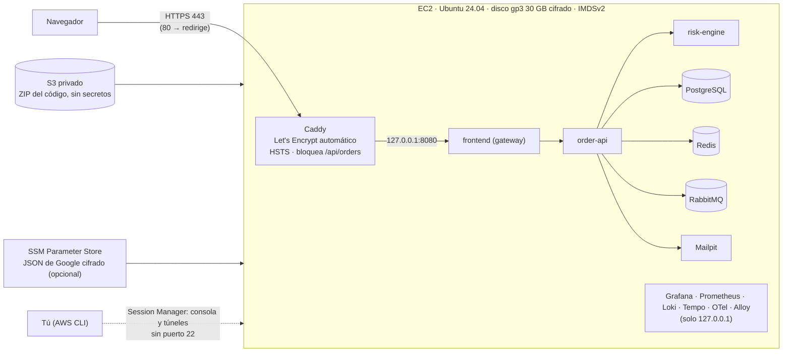

# POLYMER en AWS con Terraform y HTTPS (cuenta con plan gratuito)

> **Estado:** el código Terraform está en [`infra/aws/terraform/`](../../infra/aws/terraform) y se comprobó
> **sin cuenta de AWS**: `terraform fmt`, `terraform validate` y `terraform test` (3 escenarios con el
> proveedor simulado), sintaxis del script de arranque (`bash -n`) y contenido del ZIP del código (sin
> secretos). El CI lo repite en el job `terraform-aws` y además valida el Caddyfile con la imagen real de
> Caddy. **No se ha creado ningún recurso en AWS:** el `terraform apply` lo ejecutas tú cuando decidas.

## 1. Qué crea



| Recurso | Para qué | Costo |
| --- | --- | --- |
| `aws_instance` (EC2) | Docker Compose con los 13 contenedores + Caddy | Plan gratuito si el tipo es elegible (ver §2) |
| `aws_eip` | IP fija: el nombre HTTPS y la URI de Google no cambian al reiniciar | IPv4 pública ≈ 0,005 USD/h |
| `aws_security_group` | **Solo 80 y 443** abiertos; sin SSH | Gratis |
| `aws_iam_role` + perfil | Session Manager, leer el ZIP de S3 y **un** parámetro de SSM | Gratis |
| `aws_s3_bucket` (privado, cifrado) | El ZIP del código (≈ 15 MB) | Dentro del nivel gratuito de S3 |
| `aws_budgets_budget` (opcional) | Correo si el consumo pasa de tu límite | Gratis |

**Seguridad:** los puertos de Grafana, RabbitMQ, Mailpit y Prometheus siguen en `127.0.0.1` de la
instancia: se abren con un **túnel de Session Manager** (§6), no desde Internet. La API original del
laboratorio (`/api/orders` sin sesión) responde 403 desde Internet. Las contraseñas **se generan dentro de
la instancia** (`tools/init-env.ps1`) y nunca pasan por Terraform, S3 ni GitHub.

## 2. Plan gratuito: qué instancia elegir (léelo antes de aplicar)

Desde el **15 de julio de 2025** AWS cambió el plan gratuito. Lo que te corresponde depende de la **fecha de
creación de tu cuenta**:

| Tu cuenta | Instancias «Free tier eligible» | ¿Alcanza para POLYMER? |
| --- | --- | --- |
| Creada **desde el 15/07/2025** (plan gratuito con créditos, hasta 6 meses) | t3.micro, t3.small, t4g.micro, t4g.small, **c7i-flex.large (4 GiB)**, **m7i-flex.large (8 GiB)** | **Sí**: `m7i-flex.large` + `mode = "full"` (recomendado) o `c7i-flex.large` + `mode = "basic"` |
| Creada **antes** del 15/07/2025 (nivel gratuito clásico, 12 meses) | t2.micro / t3.micro (1 GiB, 750 h/mes) | **No**: POLYMER necesita ≈ 4,5 GB solo en contenedores (más la compilación). Cualquier tipo mayor se cobra (p. ej. `t3.large` ≈ 60 USD/mes, ver `DESPLIEGUE_AWS_HTTPS.md` §3) |

Cómo comprobarlo: consola de AWS → EC2 → *Launch instance* → en el selector de tipo, la etiqueta
**«Free tier eligible»** junto a `m7i-flex.large`. Si no la ves, **no apliques** con ese tipo.

Lo que debes saber del plan nuevo:

- El uso de EC2 **descuenta créditos** (no hay «750 horas gratis»). Una instancia de 8 GiB encendida 24/7
  gasta los créditos mucho más rápido que si la **detienes** cuando no la usas (§7).
- La IPv4 pública, el disco EBS y los snapshots tienen precio propio; no encontré confirmación oficial de
  cómo los trata el plan gratuito nuevo. Revísalo en *Billing → Free tier* y pon `budget_alert_email`.
- La alerta de presupuesto mide el consumo **antes** de créditos (`include_credit = false`): así ves
  cuánto crédito estás gastando aunque no pagues nada.

## 3. Requisitos en tu PC (Windows)

```powershell
winget install Hashicorp.Terraform
winget install Amazon.AWSCLI
winget install Amazon.SessionManagerPlugin
```

Credenciales: en la consola de AWS crea un usuario IAM para administrar (no uses la cuenta raíz), con MFA
y permisos de administrador, genera una clave de acceso y ejecuta:

```powershell
aws configure
```

(región `us-east-1`, salida `json`). Comprueba con `aws sts get-caller-identity`.

## 4. (Opcional) Google: guardar el JSON cifrado en AWS

El JSON **no** pasa por Terraform (quedaría en el archivo de estado). Lo subes tú, una vez, a SSM Parameter
Store como `SecureString` (cifrado con la clave administrada `aws/ssm`, sin costo en el nivel estándar):

```powershell
aws ssm put-parameter --region us-east-1 --name /polymer/google-oauth-json --type SecureString --value file://secrets/google-oauth.json
```

La instancia lo lee al arrancar y lo escribe en `/opt/polymer/secrets/google-oauth.json` sin imprimirlo.
Sin este parámetro, POLYMER funciona igual pero sin «Continuar con Google».

## 5. Desplegar

Desde la carpeta del proyecto:

```powershell
cd infra\aws\terraform
Copy-Item terraform.tfvars.example terraform.tfvars
notepad terraform.tfvars
```

Ajusta `instance_type` y `mode` según §2, y si quieres `budget_alert_email`. Deja `domain = ""` si no
tienes dominio. Luego:

```powershell
terraform init
terraform plan
terraform apply
```

`plan` te muestra todo lo que se creará; **nada se crea hasta que escribas `yes` en `apply`**.
Al terminar verás:

| Output | Qué es |
| --- | --- |
| `url` | `https://<ip-con-guiones>.sslip.io` (o `https://tu-dominio`) |
| `public_ip` | IP elástica (para el registro A si usas tu dominio) |
| `google_redirect_uri` | Añádela en Google Cloud → Credenciales → tu cliente OAuth → *URI de redireccionamiento autorizados* |
| `ver_progreso` / `tunel_grafana` | Comandos listos para copiar (§6) |

**La tienda tarda unos 15–25 minutos** la primera vez: la instancia instala Docker, compila las imágenes
**ejecutando las pruebas de Java y Python** y espera a que los 13 contenedores estén sanos. Mientras tanto,
la URL muestra «POLYMER se está iniciando». El candado HTTPS lo obtiene Caddy de Let's Encrypt en cuanto
la IP responde por el puerto 80.

### Sin dominio: `sslip.io`

`203-0-113-10.sslip.io` resuelve siempre a `203.0.113.10`, así que Let's Encrypt puede emitir un
certificado **válido** sin comprar dominio. Es un servicio de terceros compartido: si Let's Encrypt
rechazara la emisión por sus límites, usa un dominio propio o un subdominio gratuito de DuckDNS (registro
A hacia `public_ip`), pon `domain = "..."` y vuelve a crear la instancia (§8).

### Con dominio propio

Reserva primero solo la IP: `terraform apply -target="aws_eip.polymer"` (muestra `public_ip`). Crea el registro
**A** `tienda.tudominio.com → public_ip`, pon `domain = "tienda.tudominio.com"` y ejecuta `terraform apply`.

## 6. Administrar (sin SSH)

Consola dentro de la instancia y progreso del despliegue:

```powershell
aws ssm start-session --region us-east-1 --target <instance_id>
```

```bash
sudo tail -f /var/log/polymer-deploy.log
sudo docker ps
sudo cat /opt/polymer/secrets/demo_password.txt
```

Grafana en tu PC (`http://localhost:3000`), sin abrir puertos en AWS:

```powershell
aws ssm start-session --region us-east-1 --target <instance_id> --document-name AWS-StartPortForwardingSession --parameters portNumber=3000,localPortNumber=3000
```

Igual con `8025` (Mailpit: aquí llegan los **códigos de 6 dígitos** si no configuraste Gmail),
`15672` (RabbitMQ) y `9091` (Prometheus).

**Correo real (Gmail):** dentro de la sesión, `cd /opt/polymer && sudo pwsh tools/polymer.ps1 google`
(el mismo asistente de Windows). EC2 permite SMTP por el puerto 587. Este paso no se ha probado en EC2.

## 7. Costos bajo control

```powershell
aws ec2 stop-instances --region us-east-1 --instance-ids <instance_id>
aws ec2 start-instances --region us-east-1 --instance-ids <instance_id>
```

Detenida, la instancia no consume cómputo; los datos (PostgreSQL, etc.) se conservan en el disco y POLYMER
vuelve a arrancar solo (`restart: unless-stopped`). La IP elástica y el disco sí siguen contando.

Para **borrar todo** (incluida la base de datos de la instancia; pide confirmación):

```powershell
terraform destroy
```

El parámetro de Google lo creaste tú: bórralo con `aws ssm delete-parameter --region us-east-1 --name /polymer/google-oauth-json`.

## 8. Actualizar el código

1. En tu PC: `terraform apply` (sube el ZIP nuevo a S3; **no** recrea la instancia ni toca los datos).
2. En la instancia: `sudo polymer-update` (descarga el ZIP más reciente y ejecuta `polymer.ps1 start`;
   conserva `secrets/`, `.env` y los volúmenes).

Cambiar `domain`, `instance_type` o `mode` después del primer despliegue: `instance_type` se aplica
deteniendo y cambiando el tipo; `domain` y `mode` están en el arranque inicial, así que hay que recrear la
instancia (`terraform apply -replace=aws_instance.polymer`), **lo que borra su base de datos**.

## 9. Archivos

| Archivo | Contenido |
| --- | --- |
| `versions.tf` | Terraform ≥ 1.6, proveedores `aws` 6.x y `archive` 2.x, etiquetas comunes |
| `variables.tf` | Región, tipo, modo, dominio, correo de Let's Encrypt, disco, swap, parámetro de Google, presupuesto |
| `main.tf` | AMI Ubuntu 24.04 (parámetro público de Canonical), ZIP sin secretos, S3, IAM, grupo de seguridad, IP elástica, EC2, presupuesto |
| `outputs.tf` | URL, IP, URI de Google, comandos de Session Manager |
| `templates/user-data.sh.tftpl` | Arranque: swap, Docker, PowerShell, AWS CLI, código, `.env` público, JSON de Google, Caddy, `polymer.ps1 start`, comando `polymer-update` |
| `templates/Caddyfile.tftpl` | HTTPS automático, HSTS, bloqueo de `/api/orders`, página «se está iniciando» |
| `tests/plan.tftest.hcl` | `terraform test` sin cuenta: sslip.io, dominio propio, modo basic, t3 en modo `standard`, IMDSv2, presupuesto, modo inválido |
| `terraform.tfvars.example` | Plantilla de valores (copiar como `terraform.tfvars`, excluido de Git) |

## 10. Qué está verificado y qué no

| Comprobación | Resultado |
| --- | --- |
| `terraform fmt -check`, `validate` (aws 6.73.0, archive 2.8.1) | Correcto |
| `terraform test` con proveedor simulado (3 escenarios) | 3/3 correctos |
| ZIP del código comparado con `git ls-files`: sin `secrets/`, `.env`, `.git`, estado ni JSON de Google | Correcto |
| `bash -n` del user-data generado | Correcto |
| `caddy validate` del Caddyfile | Lo ejecuta el CI (job `terraform-aws`) |
| `terraform apply` real, emisión del certificado, arranque en EC2, Google con la URL pública | **No ejecutado**: requiere tu cuenta y tu aprobación |
